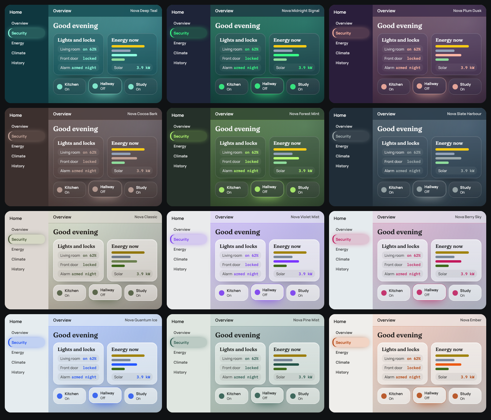

# Nova themes for Home Assistant



*All twelve themes, drawn from the generated theme file with made-up example data.*

Twelve Home Assistant frontend themes that match [Nova](https://github.com/abz2much/NOVA)'s own
panel. Pick the one you like from your profile, just as you pick a theme in Nova's settings.

Each theme is built from two seed colours, a base and an accent, by the same colour maths the Nova
panel uses. Text, surfaces, borders and status colours are worked out from those two colours, and
every text colour reaches 4.5:1 contrast on the card it sits on.

| Dark | Light |
|---|---|
| Nova Deep Teal (Nova's default) | Nova Classic |
| Nova Midnight Signal | Nova Violet Mist |
| Nova Plum Dusk | Nova Berry Sky |
| Nova Cocoa Bark | Nova Quantum Ice |
| Nova Forest Mint | Nova Pine Mist |
| Nova Slate Harbour | Nova Ember |

There is also **Nova Deep Teal Compact**: the same colours with tighter spacing, smaller type and
smaller corners, for wall tablets.

Dark themes are dark only and light themes are light only. Your profile's light and dark setting
does not change them.

## Upgrading from the single Nova theme

Earlier versions shipped one theme called **Nova** (ember and gold). That look is gone. The name
**Nova** now points to Nova Deep Teal, so dashboards and profiles that still use it keep working.
Pick any of the twelve themes above from your profile to change it.

## What you get

- Frosted glass cards over a softly lit page, with a frosted header bar (card-mod).
- Entity rows turn into pills (card-mod), and a ready-made example dashboard sits in `dashboards/`.
- A sidebar pill with an accent edge and glow, and tiles that lift and glow when you hover them (card-mod).
- Fraunces card titles and Manrope body text, with IBM Plex Mono for values and code.
- Rounder corners and a consistent shape across cards and dialogs.
- Energy dashboard colours for solar, grid and battery. In light themes they are darkened so they
  stay visible on light cards.
- Readable card editors: text fields and dropdowns follow the theme instead of showing white fields.
- Matching sidebar, header, dialogs, switches, sliders, badges and tables.

## Requirements

- A recent Home Assistant. The theme uses the newer `ha-font-*`, `ha-border-radius-*` and
  `ha-color-*` tokens, checked against Home Assistant frontend release 20260930.5. On an older
  release some of them are ignored.
- The Google Fonts resource below, for the fonts.
- card-mod is optional. See the last section.

## Install via HACS

1. HACS → the three-dot menu → **Custom repositories**.
2. Add this repository's URL, category **Theme**.
3. Install **Nova**, then restart Home Assistant (or reload themes from
   **Developer Tools → YAML → Themes**).
4. Pick a theme from your user profile (bottom-left avatar → **Theme**).

## Install manually

1. Copy `themes/nova.yaml` into your Home Assistant `config/themes/` directory.
2. Make sure `configuration.yaml` loads that folder:
   ```yaml
   frontend:
     themes: !include_dir_merge_named themes
   ```
3. Reload themes from **Developer Tools → YAML → Themes**, then pick a theme from your profile.

## Fonts

Home Assistant themes cannot load web fonts on their own. Add this as a dashboard resource, or the
theme falls back to your system fonts:

**Settings → Dashboards → ⋮ → Resources → Add Resource**
- URL: `https://fonts.googleapis.com/css2?family=Manrope:wght@400;500;600;700;800&family=Fraunces:opsz,wght@9..144,500;9..144,600&family=IBM+Plex+Mono:wght@400;500;600&display=swap`
- Resource type: **CSS Stylesheet**

Or, in YAML-mode dashboards:
```yaml
lovelace:
  resources:
    - url: https://fonts.googleapis.com/css2?family=Manrope:wght@400;500;600;700;800&family=Fraunces:opsz,wght@9..144,500;9..144,600&family=IBM+Plex+Mono:wght@400;500;600&display=swap
      type: css
```

## Good to know

- **Reload after switching theme.** Home Assistant's sidebar can keep the previous theme's colours
  until you reload the page. A reload fixes it.
- **The built-in Home (Overview) page ignores dashboard resources.** The fonts and the card-mod
  stripe show on classic dashboards, such as Security and Energy, but not on that page.

## An example dashboard

`dashboards/nova-home.yaml` is a ready-made dashboard laid out to suit the themes: a large
greeting, lists with pill-shaped rows, and a row of tiles. It uses example entity IDs, so
replace them with your own.

1. **Settings → Dashboards → Add dashboard → New dashboard from scratch.**
2. Open it, then the three-dot menu → **Raw configuration editor**.
3. Paste the contents of `dashboards/nova-home.yaml` and save.

The greeting and the pill rows need card-mod (or UIX). Without it, the dashboard still works,
only plainer.

## Optional card-mod accents

Each theme carries a small card-mod section: a thin accent stripe along the top of every card and
a soft glow on hover. It only does anything if you have the
[card-mod](https://github.com/thomasloven/lovelace-card-mod) HACS integration (or its successor,
UIX) installed. Without it, Home Assistant ignores those keys and nothing else changes.

card-mod keys are not checked by Home Assistant, so a mistake there fails silently. If the stripe
does not show, check card-mod's own inspector before blaming the theme.

## For maintainers

`themes/nova.yaml` is generated. Do not edit it by hand.

```sh
node scripts/generate-theme.mjs     # writes themes/nova.yaml from the 12 seed colours
python3 scripts/check_theme.py      # needs PyYAML; checks themes, tokens and contrast
```

The seed colours and the colour maths live in `scripts/nova-colours.mjs`, copied from Nova's
panel. If Nova's themes change, copy them again, then run the two commands above.
